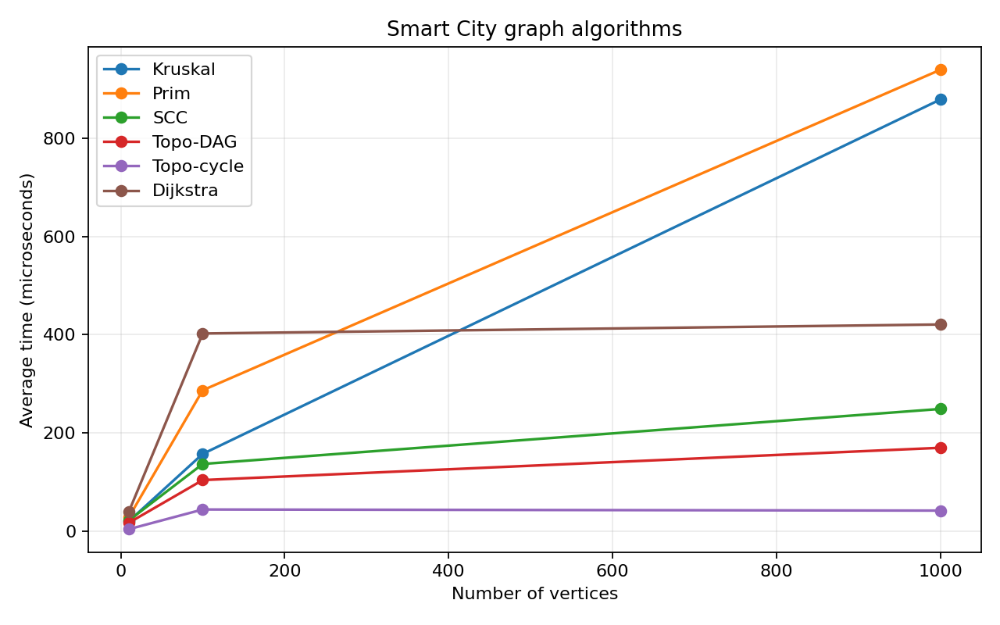
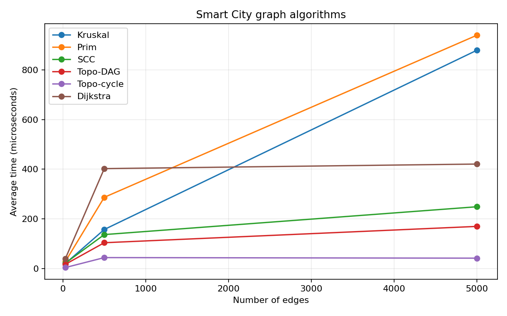

# Assignment 3 - Smart City

Ibrokhimov Sultonbek, group: SE-2501

## Overview

This Java program represents districts as vertices and roads as weighted edges.
It finds a low-cost infrastructure network, checks directed connections and finds shortest routes.
Vertices are numbered from 0. The example in Main uses five named districts.

## Run

Java 17 (JDK) is required. No Java libraries are needed.

```bash
bash run.sh
bash run.sh test
bash run.sh benchmark
```

Run these commands from the project folder. On Windows, use Git Bash, or open
`src` as a source folder in IntelliJ and run Main, Tests or Main with argument `benchmark`.

To compile manually on any system with a JDK:

```bash
javac -d out src/graph/*.java src/dsu/*.java src/mst/*.java src/connectivity/*.java src/shortestpath/*.java src/*.java
java -cp out Main
java -cp out Tests
java -cp out Main benchmark
```

To rebuild the plots, install Python's matplotlib and run `python3 plot_results.py`.
The existing PNG plots can be viewed without Python.

## Implementation

- `graph/Graph`: adjacency lists and an edge list. Undirected roads appear twice
  in adjacency lists, but once in the edge list.
- `dsu/DSU`: find with path compression and union by rank.
- `mst/MST`: Kruskal sorts edges and uses DSU. Prim uses a priority queue.
  Both return selected edges, total weight and component count.
  Disconnected input returns a minimum spanning forest and connected=false.
- `connectivity/Connectivity`: Kahn's algorithm for topological ordering and
  Kosaraju's two DFS passes for SCC. A cyclic graph returns an empty order and cycle=true.
- `shortestpath/Dijkstra`: a priority queue, distance array and parent array.
  Old queue entries are skipped. Paths are reconstructed using parents.
  Unreachable vertices have Long.MAX_VALUE and an empty path.
- `Main`: a small demonstration. `Benchmark`: experiments. `Tests`: correctness checks.

Dijkstra rejects negative weights. With a negative edge, a vertex taken from the
queue may later receive a shorter distance, so the usual greedy correctness and
running-time guarantees no longer apply. Bellman-Ford is a better choice for that case.

## Complexity Analysis

V is the number of vertices and E is the number of stored roads. The graph uses
O(V+E) memory. Space below is extra memory, apart from the input graph.

| Algorithm | Time | Extra space |
| --- | --- | --- |
| DSU initialization | O(V) | O(V) |
| DSU find / union | O(alpha(V)) amortized per operation | O(log V) worst-case recursive find stack |
| Kruskal | O(V + E log(E+1)) | O(V+E) |
| Prim | O(V + E log(E+1)) | O(V+E) |
| Kosaraju SCC | O(V+E) | O(V+E) |
| Topological ordering | O(V+E) | O(V) |
| Dijkstra | O(V + E log(E+1)) | O(V+E) |

DSU's alpha(V) grows very slowly. Rank keeps trees shallow and path compression
makes later finds point directly to the root. Without these improvements, a bad
sequence of merges can create long chains.

The heap is Java's binary-heap PriorityQueue. Prim stores candidate edges and
Dijkstra can store several entries for the same vertex, so the queue can use O(E)
space. On these simple graphs, log E is O(log V), giving the familiar
O((V+E) log V) bounds. SCC and topological ordering scan adjacency lists rather
than sort them. More edges therefore add linear work to these algorithms.
Recursive DFS is simple for this assignment, but much deeper graphs may need
an iterative DFS to avoid stack overflow.

## Experimental Setup

| Size | V | E |
| --- | ---: | ---: |
| Small | 10 | 30 |
| Medium | 100 | 500 |
| Large | 1000 | 5000 |

All generated graphs use seed 42 and weights from 1 to 100. There are no self-loops
or parallel edges in the experiments. The generator first adds an undirected
chain for MST and Dijkstra graphs, then random unique roads until E is reached.
This guarantees connectivity.

DAG edges always go from a smaller vertex number to a larger one. Cyclic directed
graphs start with a directed ring through every vertex, followed by random unique
arcs. Thus each cyclic experimental graph has one SCC; the DAG has V singleton
SCCs, although SCC timings here use the cyclic graph only.

Each algorithm has 20 warm-up calls, then 5 timed calls on the same graph.
System.nanoTime() measures algorithm execution, including result allocation and
operation counting. Generation, printing and CSV writing are outside the timer.
The environment used OpenJDK 17.0.20 on Linux. Fixed seeds reproduce the input
and operation counts; elapsed times vary with machine load, JIT and garbage collection.
Five repetitions give a basic comparison, not a precise performance ranking.

## Results

Times are averages of five runs, in microseconds.

| Algorithm | V=10, E=30 | V=100, E=500 | V=1000, E=5000 |
| --- | ---: | ---: | ---: |
| Kruskal | 19.85 | 157.00 | 879.49 |
| Prim | 28.11 | 286.71 | 940.03 |
| SCC | 21.52 | 136.48 | 248.66 |
| Topo-DAG | 16.71 | 103.68 | 169.47 |
| Topo-cycle | 3.61 | 43.72 | 41.47 |
| Dijkstra | 39.52 | 402.38 | 420.73 |

The table below gives operation counts for the largest graph. The CSV files contain
all sizes and the 90 individual timed runs.

| Algorithm | Edge examinations | Comparisons | Find calls | Union calls |
| --- | ---: | ---: | ---: | ---: |
| Kruskal | 3106 | 50438 | 11888 | 3106 |
| Prim | 10000 | 111381 | 0 | 0 |
| SCC | 15000 | 0 | 0 | 0 |
| Topo-DAG | 10000 | 0 | 0 | 0 |
| Topo-cycle | 5000 | 0 | 0 | 0 |
| Dijkstra | 15000 | 36630 | 0 | 0 |

Comparisons mean weight comparisons in Kruskal's sorting or in Prim/Dijkstra's
priority queues. Find calls include recursive calls. Zero means that counter does
not apply. These are separate kinds of work and should not be added into one score.
Dijkstra counts its E-edge weight-validation pass and adjacency scans. SCC counts
both DFS scans and construction of the reversed graph. Topological ordering counts
indegree construction and edges processed by Kahn's queue.





Both plots use the same three configurations: V and E increase together. They do
not isolate the effect of changing only V or only E.

## Comparison and Discussion

Kruskal was faster than Prim in these runs. It sorts all E edges but can stop after
V-1 accepted edges on connected input. Prim examined both directions of every
road and made more heap comparisons. This result depends on graph shape and
implementation; it does not show that Kruskal is always faster.

SCC edge examinations grow from 90 to 1500 to 15000, matching three passes over E.
The measured time also grows, but not at a constant rate because small timings
include substantial runtime overhead and JIT effects.

DAG topological ordering examines 2E edges. The ring-based cyclic input has no
zero-indegree vertex, so it detects failure after the E-edge indegree pass.
It still costs O(V+E), but performs less work on these particular inputs.

Dijkstra's edge counts grow from 90 to 1500 to 15000. Heap comparisons also grow.
The medium and large timings are quite close despite different operation counts,
which shows why these short JVM measurements should be interpreted carefully.

## Testing

Run `bash run.sh test`. The saved run passed 10112 checks.

Tests cover a single vertex, disconnected components, unreachable destinations,
cycles, a self-loop, zero weights, equal weights and several possible MSTs.
There are known MST weights, DSU merge checks and 30 seeded random test rounds.
Kruskal and Prim are compared, including edge counts and cycle-free returned forests.

For directed graphs, an independent transitive-closure calculation checks SCC
membership: two vertices share an SCC exactly when they can reach each other.
Every vertex must occur once. DAG orders are checked against every edge, and
cyclic graphs must reject topological ordering.

Dijkstra distances are compared against Floyd-Warshall. Reconstructed paths must
contain real edges and have the reported total distance. Negative weights must
be rejected. See `results/tables/tests.txt` and `demo.txt` for saved output.

## Conclusion

MST algorithms are useful for connecting districts at minimum construction cost.
SCC finds mutually reachable groups, while topological ordering works for services
with acyclic dependencies. Dijkstra finds routes when distances are non-negative.
For these experiments, Kruskal used fewer comparisons than Prim; the linear graph
algorithms scanned fewer structures and generally took less time on larger inputs.
